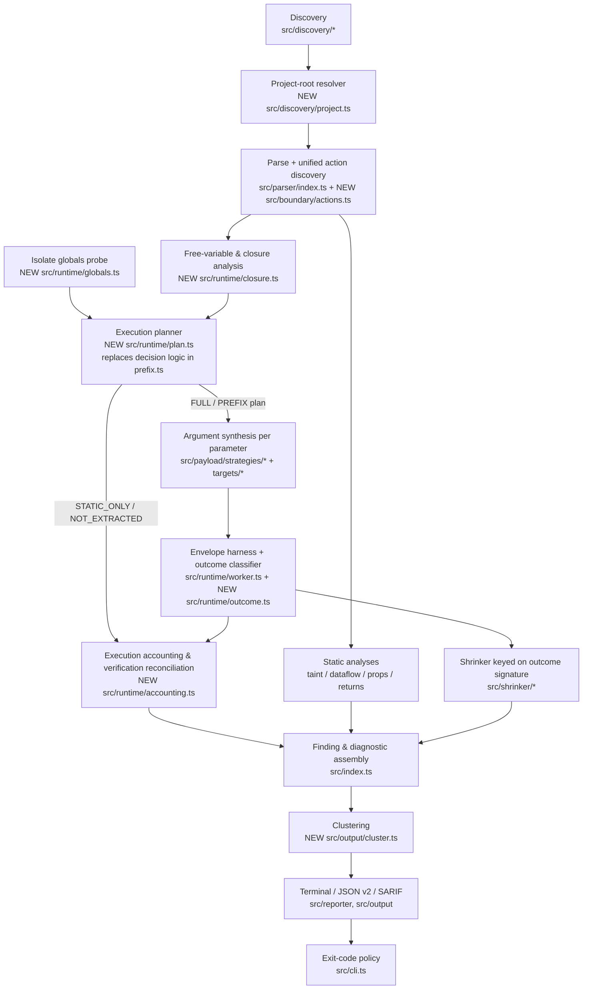
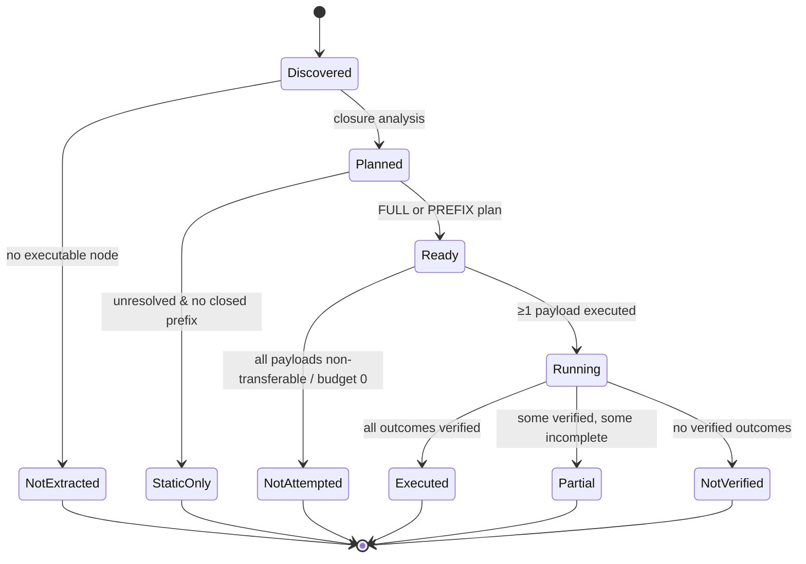
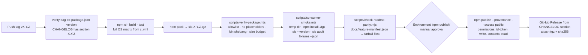
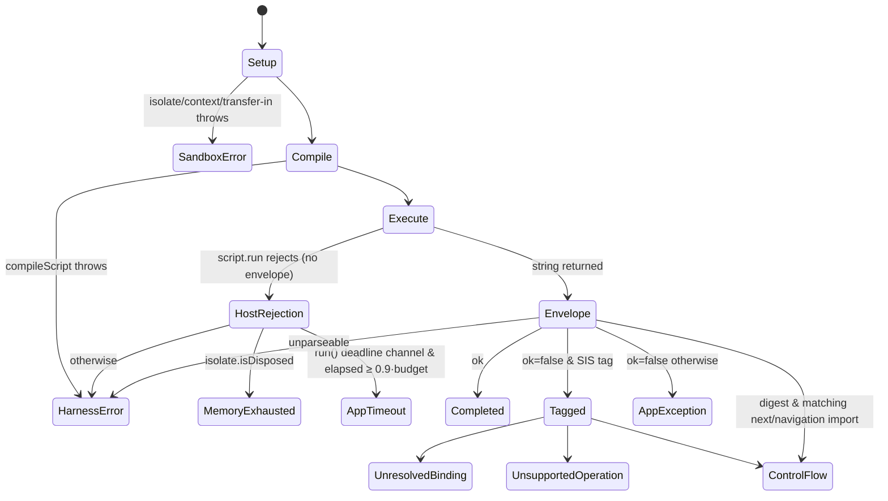
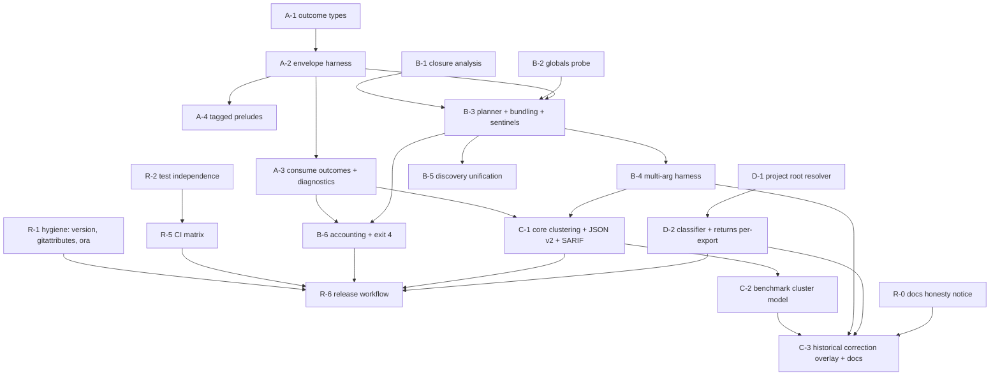

# SIS — Phase 3: Reliability Reset & Remediation Design

| | |
| :--- | :--- |
| **Baseline** | `585af3d` (local `master`; remote `main` = `cbd7d8e`, which adds only docs/templates) |
| **Inputs** | `audit/PHASE-1-REPOSITORY-INTELLIGENCE.md`, `audit/PHASE-2-FINDINGS-VALIDATION.md` (primary source of truth; defect IDs `V-xx`) |
| **Date** | 2026-11-01 |
| **Status** | **Design only.** Nothing described here has been implemented or verified. Every "expected" behavior below is a requirement, not an observation. |
| **Scope rules honored** | No source, dependency, lockfile, or benchmark-data changes. No commits, tags, pushes, or publishes. Historical benchmark data is preserved; corrections are designed to be additive. |

---

## 1. Executive summary

Phase 2 traced SIS's trust failures to seven root causes (RC-1 … RC-7). This design addresses them with five structural changes. Each one is small enough to land independently behind tests.

1. **An evidence-based outcome model (Workstream A).** Every execution yields a tagged `ExecutionOutcome` with explicit provenance. The candidate runs inside an **in-isolate envelope** that catches application throws, inspects the return value, and returns a plain JSON description. The host never clones arbitrary values. Any host-side error is therefore, by construction, an isolate-level event: timeout, memory disposal, or a harness defect. Message-substring classification (`src/runtime/worker.ts:82-102`) is removed. SIS003 and SIS004 are narrowed to application-attributed outcomes. A new family of **diagnostics** (`SIS101`–`SIS107`) carries everything SIS caused or couldn't verify.

2. **An execution plan built from free-variable analysis (Workstream B).** Before execution, SIS computes the action's free variables and resolves each one against:
   - module-scope declarations, bundled when safe;
   - an **empirically probed** list of the globals the isolate actually provides;
   - import-bound framework preludes.

   FULL and PREFIX become claims about a *closed* program. Whatever can't be resolved is installed as a **tagged sentinel**, so reaching it produces an `unresolved-binding` outcome rather than a `ReferenceError` that has to be guessed at. Each action's verification status is then **reconciled with what actually ran**: a FULL plan whose executions never completed is reported as `NOT_VERIFIED`, not FULL. The harness passes **every** parameter. An audit with zero verified executions exits **4 (inconclusive)**, never 0.

3. **A four-level benchmark identity model (Workstream C).** The levels are payload observation, finding instance, root-cause cluster, and independent confirmed defect. Cluster fingerprints exclude payload ordering, seed, and strategy. Historical review data stays byte-for-byte unchanged; corrections go in an **append-only overlay** with reviewer, date, and evidence. Published metrics move to cluster and defect counts, with SIS-caused artifacts counted as false alarms. No recall figures are claimed without a known denominator.

4. **Project-root-relative path semantics (Workstream D).** Next.js conventions (`app/**/route.*`, `pages/api/**`, `src/app`) are evaluated against the **Next.js project root**, discovered per file. They are no longer evaluated against the audit root. Directives always outrank path heuristics.

5. **Gated, CI-only releases and a platform-honest CI (Workstreams E, F).**
   - Single-source versioning.
   - Retro-tagging the historical `0.1.0` (pending approval).
   - Tag-triggered release with build, test, tarball inspection, clean-consumer smoke test, README/package parity, and `--provenance`.
   - A least-privilege push/PR CI matrix across Linux, macOS, and Windows on explicit Node versions.

   Platform support is claimed only after a matrix job passes.

**Expected visible effect once implemented:** reported runtime finding counts will **fall**, most notably the commerce cluster and the shadcn dynamic-import findings. New "not verified" coverage numbers will **expose** how little code currently executes. That is the intended reset. Both effects need to be explained in the changelog (§10).

---

## 2. Proposed architecture



**Layering rules (new):**
- `runtime/outcome.ts` has no dependencies other than types. It is the only place where a raw isolate result becomes a classified outcome.
- `runtime/plan.ts` is the only producer of an `ExecutionMode`. `runtime/compatibility.ts` keeps only `isPayloadTransferable` (`:20-115`). The name denylists (`:136-186`) move to `plan.ts` as *fallback hints*, which also breaks the `compatibility` ↔ `prefix` cycle (V-25).
- `src/index.ts` stops building findings inline. Both pipeline variants (`:73-336`, `:342-749`) call one per-file function, `analyzeFile()`, and a shared `assembleResult()`. This removes the duplicated finding construction at `:185-235` / `:514-564` and the drift between single-file and directory mode (V-20).

---

## 3. Current vs proposed behavior

| Situation | Current (`585af3d`, verified in Phase 2) | Proposed |
| :--- | :--- | :--- |
| Action returns `() => 1` / Symbol / `Promise<fn>` | `failed` → SIS003 (`worker.ts:71-75`, `:103-110`) | `completed` with `result.transferable = false` → diagnostic SIS105 (no finding) |
| `await import("x")` | `failed` "Not supported" → SIS003 | Planner marks a `dynamic-import` dependency. If reached: `unsupported-operation` → SIS102 |
| Isolate OOM | `failed` → SIS003 | `memory-exhausted` → SIS104 (diagnostic; promoting it to a finding is Decision D6) |
| `throw new Error("Script execution timed out")` | `timeout` → SIS004, message overwritten | `app-exception` (message preserved) → SIS003 |
| Genuine infinite loop | `timeout` → SIS004 | `app-timeout` → SIS004 (unchanged semantics; detection by channel) |
| Typo `undefinedThing` | `unsupported` (hidden) | `app-exception` → SIS003 (the name isn't in the unresolved set) |
| Module helper not bundled | `unsupported` ×N; action stays FULL | Helper bundled → executes; or sentinel → `unresolved-binding`; action `NOT_VERIFIED` |
| `Error("NEXT_REDIRECT …")` from user code | `passed` | `app-exception` |
| Prelude `redirect()` | `passed` | `control-flow` (`kind: redirect`) |
| Two-parameter action | Only arg 0 passed → fabricated SIS003 | Every parameter gets a baseline; one parameter mutated per payload; the mutated parameter is recorded |
| Aliased / default / named-default export | Never executes; uncounted | Executes via the local binding or a synthesized `__sis_default` |
| Zero completed executions | Exit 0, "clean" | Exit 4 "inconclusive" plus SIS107 |
| 9 payloads, same crash | 9 findings, 9 fingerprints | 1 cluster (`occurrences: 9`), 1 SARIF result with `partialFingerprints` |
| Audit `app/api` subdirectory | Route handlers judged as Server Actions (V-07) | Classified relative to the detected project root; identical to auditing the project root |

---

## 4. Detailed subsystem designs

### 4.A Workstream A — Runtime verdict integrity (P0)

#### A.1 Execution phases and provenance

| Phase | What happens | Where today | Errors here are attributed to |
| :--- | :--- | :--- | :--- |
| `setup` | `new ivm.Isolate`, `createContext` | `worker.ts:49-51` | `sandbox` |
| `transfer-in` | `ExternalCopy(payload)` → context | `worker.ts:53-54` | `sandbox` (payload pre-checked by `isPayloadTransferable`) |
| `compile` | `compileScript(harness)` | `worker.ts:66` | `harness` (SIS generated invalid code) |
| `execute` | Candidate runs inside the envelope | `worker.ts:71-75` | `candidate`, `prelude`, `sentinel`, or `isolate` (see A.3) |
| `transfer-out` | Copy the envelope (a JSON string) to the host | currently `copy: true` on an arbitrary value | `harness` |
| `teardown` | release / dispose | `worker.ts:120-143` | ignored, but logged in debug |

#### A.2 The envelope harness (replaces `worker.ts:58-64`)

The harness is generated by a new function, `buildHarness(plan, argsCount)`, in `src/runtime/worker.ts`. It:

1. **Captures intrinsics first** (`JSON.stringify`, `Object.prototype.toString`, `Array.isArray`, `Reflect.ownKeys`, `Error`), before any candidate or bundled module code runs. Candidate code that tampers with globals then can't break classification. If it does break it, the result is a harness error, never an app finding.
2. Installs the **preludes** declared by the plan (import-bound, see B.6) and the **sentinels** for unresolved bindings (B.4).
3. Evaluates the bundled module declarations, then the candidate.
4. Runs `await <localBinding>(...__sisArgs)` inside `try { … } catch (thrown) { … }`.
5. Returns `__sisJSON.stringify(envelope)`, a **string**. The host copies only that string.

Envelope shape (inside-isolate JSON):

```ts
type Envelope =
  | { v: 1; ok: true;  value: ValueDescription; unhandledRejections: number }
  | { v: 1; ok: false; thrown: ThrownDescription; unhandledRejections: number };

interface ThrownDescription {
  isError: boolean;                 // thrown instanceof captured Error
  typeOf: string;                   // typeof thrown
  name?: string; message?: string; stack?: string;
  digest?: string;                  // Next.js digest property if present
  sisTag?: SisSentinelTag;          // set ONLY by SIS-owned sentinels/preludes (unforgeable, see A.3)
  preview: string;                  // bounded, safe preview for non-Error throws
}

interface ValueDescription {
  kind: "undefined" | "null" | "primitive" | "plain-object" | "array" | "builtin" | "class-instance"
      | "function" | "symbol" | "promise" | "other";
  transferable: boolean;            // structured-clone-safe (isolate→host)
  flightSerializable: boolean | "unknown"; // React Flight return-value compatibility (best effort)
  preview: string;                  // bounded
}
```

**Why this fixes host-side serialization (V-02).** Return values are described *inside* the isolate. The host only ever receives an `ExternalCopy` of a string, so "could not be cloned" can no longer come from application values. If a host-side copy does fail now, that is a harness defect and gets classified as such.

#### A.3 Unforgeable SIS tags

Preludes (`src/runtime/preludes/navigation.ts:22-110`) and sentinels attach a tag through a `Symbol` that SIS creates when the harness starts and never exposes to candidate code: `const __sisTag = Symbol()`, held only in a closure. `ThrownDescription.sisTag` is filled in only when `thrown[__sisTag]` exists. Message text plays no part in classification. A user error that says `"NEXT_REDIRECT"` or `"Script execution timed out"` is just an application exception.

`SisSentinelTag = { kind: "control-flow", flow: "redirect" | "not-found" } | { kind: "unresolved-binding", name } | { kind: "unsupported-operation", op }`.

Next.js `digest` handling: a non-SIS error whose `digest` starts with `NEXT_REDIRECT` or `NEXT_NOT_FOUND` is classified as `control-flow`, but **only if** the action imported the corresponding `next/navigation` export (provenance taken from the plan). Otherwise it's an `app-exception` with `digest` recorded. Re-thrown framework signals get credit only where they are plausible.

#### A.4 Outcome taxonomy (the ten required categories)

| # | Required category | `OutcomeKind` | Verified about the app? | Group | Default surface |
| :-: | :--- | :--- | :-: | :--- | :--- |
| 1 | Application exception | `app-exception` | yes | verified | **SIS003** finding |
| 2 | Application timeout | `app-timeout` | yes | verified | **SIS004** finding |
| 3 | Sandbox infrastructure failure | `sandbox-error` (setup / transfer-in / teardown), `harness-error` (compile / transfer-out / envelope invalid) | no | incomplete | SIS103 diagnostic |
| 4 | Host-side serialization failure | *eliminated by design.* A non-transferable return becomes `completed` + `value.transferable=false`; a residual host copy failure becomes `harness-error` | — | — | SIS105 diagnostic (note) |
| 5 | Unsupported runtime operation | `unsupported-operation` (`op`: `dynamic-import`, `eval`, `with`, `timers`, …) and `unresolved-binding` (`name`) | no | incomplete | SIS102 / SIS101 diagnostic |
| 6 | Memory exhaustion | `memory-exhausted` (`limitMb`) | partially (input-dependent, but bounded by the SIS limit) | incomplete | SIS104 diagnostic (D6) |
| 7 | Framework control-flow termination | `control-flow` (`flow`) | yes | verified | none |
| 8 | Successful execution | `completed` | yes | verified | none |
| 9 | Execution not attempted | `not-attempted` (`reason`: `payload-not-transferable`, `plan-static-only`, `not-extracted`, `budget`) | no | not-attempted | counted; SIS106 per action |
| 10 | Attempted but not completed | the **incomplete** group: `unresolved-binding`, `unsupported-operation`, `sandbox-error`, `harness-error`, `memory-exhausted` | no | incomplete | counted; drives `NOT_VERIFIED` |

#### A.5 Classification rules (deterministic, in order)

Implemented as the pure function `classifyOutcome(raw: RawIsolateResult, plan: ExecutionPlan): ExecutionOutcome` in `src/runtime/outcome.ts`.

```
1. setup/transfer-in threw                         → sandbox-error
2. compile threw                                   → harness-error (phase=compile)
3. script.run rejected (no envelope returned):
   a. isolate.isDisposed === true                   → memory-exhausted     (isolated-vm disposes on OOM)
   b. elapsed ≥ 0.9·timeoutMs AND error originated
      from isolated-vm's run() (host channel)       → app-timeout
   c. otherwise                                     → harness-error (phase=execute)
   (App code cannot reach this channel: its throws are caught by the envelope.)
4. envelope missing/unparseable                    → harness-error (phase=transfer-out)
5. envelope.ok === true                            → completed (value description attached)
6. envelope.ok === false:
   a. thrown.sisTag.kind === "unresolved-binding"  → unresolved-binding
   b. thrown.sisTag.kind === "unsupported-operation" → unsupported-operation
   c. thrown.sisTag.kind === "control-flow"        → control-flow
   d. digest NEXT_REDIRECT/NOT_FOUND AND plan.imports includes matching next/navigation export
                                                    → control-flow
   e. otherwise                                     → app-exception (ReferenceError included)
```

**Timeout identification.** The deadline is enforced by isolated-vm's `timeout` option, unchanged. Classification relies on the *channel*: a rejection from `script.run` itself, with no envelope. Message text isn't used. App code can't forge it because termination can't be caught in V8, and app throws never leave the envelope. The 0.9 × budget floor guards against a harness bug being misread as a timeout. Phase 2 showed the deadline also covers execution after `await`, so no change is needed there.

**Memory identification.** Probe-verified: isolated-vm surfaces OOM as a rejection and the isolate is disposed. The rule is `isolate.isDisposed` after rejection. It doesn't depend on message text.

**Unsupported operations.** Detected **statically first** (B.3: `import()`, `eval`, `new Function`, `with`, timer functions when absent) and rewritten during the existing `swc.transformSync` step (`executor.ts:144-152`) into calls to an SIS sentinel that throws a tagged error. The runtime rule then applies by tag, never by the message "Not supported".

**Unhandled rejections (V-24).** Counted in the envelope through a capture shim. Default policy is a diagnostic only (D6).

#### A.6 Finding and diagnostic codes

SIS003 and SIS004 remain **findings**, now restricted to `app-exception` and `app-timeout` outcomes in an action with a verified plan. New **diagnostics** are reported separately and never affect exit code 1:

| Code | Name | Level | Emitted per |
| :--- | :--- | :--- | :--- |
| SIS101 | unresolved-binding | warning | action (aggregated by binding name) |
| SIS102 | unsupported-operation | warning | action × op |
| SIS103 | sandbox-infrastructure-failure | error (engine) | audit (aggregated) |
| SIS104 | memory-limit-reached | warning | cluster (action × signature) |
| SIS105 | return-not-transferable | note | action |
| SIS106 | action-not-verified | warning | action (status `NOT_VERIFIED` / `NOT_EXTRACTED` / `STATIC_ONLY`, with reasons) |
| SIS107 | audit-inconclusive | error | audit (zero verified executions while ≥ 1 action is discovered, or zero files analyzed) |

**Should SIS003 be split?** Yes, along the attribution axis described above. Infrastructure outcomes leave SIS003 entirely. Within SIS003, `verification: "runtime"` plus `arity: "complete" | "omitted"` (from B.7) distinguishes a crash under a complete argument vector from an arity-robustness crash. I don't recommend further splitting by error constructor; that belongs in the cluster key (C.2), not the rule ID. SIS005 stays reserved and undocumented as a finding until a producer exists (V-16).

#### A.7 CLI presentation (`src/reporter/terminal.ts`)

- Replace "verified findings" (`terminal.ts:511-514`) with two counts: **"runtime-confirmed findings"** (SIS003/SIS004 clusters) and **"static findings"** (SIS001/SIS002).
- New **Verification coverage** block, always printed:
  ```
  Verification coverage
    Actions discovered 7 · eligible 5 · executed 3 · partially executed 1 · not verified 1 · static-only 2
    Payloads planned 60 · completed 31 · app exceptions 9 · not attempted 6 · incomplete 14
    Top reasons not verified: unresolved binding `db` (2) · dynamic import (1)
  ```
- When verification is inconclusive (SIS107), print a prominent banner and exit 4 (§4.B.9).
- Findings are listed per **cluster**, showing an occurrence count, the minimized reproducer, and the mutated parameter.

#### A.8 JSON representation (schema `version: "2"`)

`src/output/types.ts` gains the following (v1 types are kept for `--format json-v1`, §8):

```ts
interface JsonAuditReportV2 {
  version: "2";
  tool: JsonToolInfo;                 // version from package.json (E.1)
  target: string; projectRoots: string[];
  summary: {
    runtimeConfirmedClusters: number; staticFindings: number;
    findingInstances: number; diagnostics: number; inconclusive: boolean;
  };
  coverage: AuditCoverage;            // §5
  clusters: JsonFindingCluster[];     // findings grouped (C.2)
  findings: JsonFinding[];            // instances; each carries clusterId
  diagnostics: JsonDiagnostic[];      // SIS101–SIS107
  actions: JsonActionVerification[];  // per-action plan + observed status + outcome histogram
  errors: AnalysisError[];
}
```

Each runtime `JsonFinding` gains `outcome: { kind, phase, attribution }`, `arguments: { index, name, role: "mutated" | "baseline" | "omitted" }[]`, and `clusterId`.

#### A.9 SARIF representation (`src/output/sarif.ts`)

- `results[]` contains **findings only**, one result per **cluster**. `partialFingerprints: { "sis/cluster/v1": <clusterKey> }`. `occurrenceCount` sits in `properties`, and up to five instance locations go in `relatedLocations`.
- Diagnostics are emitted as `runs[0].invocations[0].toolExecutionNotifications[]`, with descriptors in `tool.driver.notifications[]` (IDs SIS101–SIS107). That matches the SARIF 2.1.0 split between results and tool notifications.
- `invocations[0].executionSuccessful = false` whenever SIS103 or SIS107 is present.
- URIs are relative to the **repository root** (git top-level, else the project root), with `originalUriBaseIds.SRCROOT` set. This fixes V-17 together with D.4.

---

### 4.B Workstream B — Execution integrity (P0)

#### B.1 What FULL and PREFIX mean (proposed contract)

The **planned mode** is a static claim. The **verification status** is the observed result. Both are reported. Only the verification status is ever described as "verified".

| Planned mode | Static precondition (all must hold) |
| :--- | :--- |
| `FULL` | Every free variable of the action (body, parameter defaults, bundled declarations, transitively) resolves to a bundled module declaration, a probed isolate global, an import-bound prelude, or a parameter or local. No `unsupported-operation` nodes are present. |
| `PREFIX` | There is a non-empty statement prefix `S[0..k)` closed under resolution. All `FunctionDeclaration`s in the body (they're hoisted) are either included, if resolved, or replaced by sentinels. The cut statement `S[k]` and its dependency are recorded. |
| `STATIC_ONLY` | Neither of the above holds. Concrete unresolved dependencies are listed (names *with* import source and reference kind). |
| `NOT_EXTRACTED` | Discovered but no executable node could be produced (a harness defect, so SIS106 is emitted with the reason). |

| Observed verification status | Rule (from the outcome histogram of attempted payloads) |
| :--- | :--- |
| `EXECUTED` | ≥ 1 attempted, and every attempted payload is in the **verified** group |
| `PARTIAL` | ≥ 1 verified and ≥ 1 incomplete |
| `NOT_VERIFIED` | ≥ 1 attempted and 0 verified (e.g. every run hit a sentinel) |
| `NOT_ATTEMPTED` | 0 attempted (static-only, not extracted, or every payload non-transferable) |

**FULL never appears alone in output.** It's always `plan: FULL, status: <observed>`. The terminal and SARIF summary text only say an action was "verified" when its status is `EXECUTED` or `PARTIAL`. For `PARTIAL`, the verified fraction is shown.



#### B.2 Free-variable analysis (new `src/runtime/closure.ts`)

A scope-aware walker over the SWC AST. It replaces the context-free identifier scan in `src/runtime/prefix.ts:79-126`, which counts property names and object keys (V-13).

- **References counted:** `Identifier` in expression position. **Excluded:** non-computed `MemberExpression.property`, object-literal and pattern keys, labels, every TypeScript type position (`typeAnnotation`, `typeParameters`, `TsInterface`, `TsTypeAlias`, `satisfies`/`as` type sides), JSX attribute names, and import/export specifiers.
- **Scopes:** function (params including default-value expressions and destructuring), block (`let`/`const`/`class`), `catch` param, `for` heads, and named function expressions. Function declarations and `var` hoist to the function scope. That handles `later()` called before it's declared (Phase 2 probe `c26`).
- **Special forms:** `this` and `arguments` are allowed. `eval`, `with`, and `new Function` → `unsupported-operation`. Dynamic `import()` (`CallExpression` with callee `Import`) → `unsupported-operation: dynamic-import`. `require(...)` → unresolved `require`. JSX → requires a JSX runtime, so `unsupported-operation: jsx` unless the bundled transform provides one (out of scope; treated as unsupported).
- **Output:** `FreeVariables = Map<name, { refs: Span[], kinds: ("call" | "read" | "write" | "typeof")[] }>`.
- **Unit-testable in isolation.** Pure function of `(fnNode, moduleAst)`.

#### B.3 Binding resolution

For every free variable, in priority order:

| Source | Rule | Effect |
| :--- | :--- | :--- |
| Parameter or local | Handled by scope analysis | — |
| **Module declaration** | `FunctionDeclaration`, `ClassDeclaration`, `TsEnumDeclaration`, `VariableDeclaration` at module top level (exported or not) | Candidate for bundling (B.5) |
| **Import, prelude-bound** | Import from `next/headers` (`cookies`, `headers`), `next/navigation` (`redirect`, `notFound`), or `next/cache` (`revalidatePath`, `revalidateTag`, `unstable_noStore`) | Bind the prelude. **The name alone no longer suffices.** This replaces `isPreludeSupported(name)` (`src/runtime/preludes/index.ts:33-35`) with `resolvePrelude(importSource, importedName)` |
| Import, other | Classified by kind: `relative` (project module), `alias` (`@/…`, `~/…`, resolved later via V-09), `package`; with `framework` / `cloud-sdk` hints from `EXTERNAL_CLOUD_PACKAGE_PATTERNS` (`compatibility.ts:166-186`) | Unresolved (phase 1). Relative/alias bundling is Decision D5 |
| **Isolate global** | Present in `ISOLATE_GLOBALS` (B.8) | Resolved |
| Known host-only global | `process`, `require`, `fetch`, `Buffer`, `setTimeout`, `crypto`, `URL`, … (probed absent) | Unresolved, reason `host-global` |
| Unknown | Anything else | Unresolved, reason `unknown-global` |

The reason labels fix the mislabeling in `prefix.ts:40-45` (V-13). Relative imports are no longer called `cloud-sdk`, and `next-auth` is no longer `framework-boundary`.

#### B.4 Sentinels for unresolved bindings

For every unresolved name that is **not** on the planned execution path but is referenced by bundled or prefix code, the harness defines:

```js
Object.defineProperty(globalThis, "<name>", { configurable: true, get() { throw __sisSentinel({ kind: "unresolved-binding", name: "<name>" }); } });
```

so that reaching it produces a tagged `unresolved-binding` outcome (A.5 rule 6a). **Trade-off:** `typeof <name>` on a sentinel throws instead of returning `"undefined"`. The planner records `typeof` references (B.2 `kinds`) and, for those names only, defines a non-throwing `undefined` binding, marking the action `PARTIAL`-eligible. Because of sentinels, any `ReferenceError` that *does* reach the envelope is attributable to the application (a typo). That fixes the blanket suppression in V-06.

#### B.5 Module bundling (closes V-03 for module scope)

The planner computes the transitive closure of module declarations reachable from the action's free variables, then emits them in **source order** (preserving TDZ semantics), filtered as follows:

| Declaration | Bundled? | Notes |
| :--- | :--- | :--- |
| `function`, `class` | Yes | Their own free variables are resolved recursively |
| `enum` (TS) | Yes | Compiled by the existing `swc.transformSync` (`executor.ts:144-152`) |
| `const`/`let`/`var` with a **pure initializer** (literals, object/array/template of pure parts, arrow/function expressions, `as const`, references to other pure declarations) | Yes | |
| `const`/`let` with an **impure initializer** (any call, `new`, `await`, member access on unresolved bindings) | No (phase 1) → sentinel | Prevents running module-initialization side effects; impure initializers are Decision D5 |
| Mutable `let` state | Yes, fresh per execution | **Semantic difference, documented:** Next.js shares module state across requests; SIS resets it per payload. Recorded in the plan as `moduleStateReset: true` |
| Other exported actions | Yes, as functions | Fixes probe `c15` |

**Exports.** The planner invokes the **local binding**, fixing aliases (`executor.ts:50-78`). Default exports are emitted as `const __sis_default = <function expression>`, which works for both anonymous and named defaults (`executor.ts:80-103`). Extraction failures no longer `return null` silently (`executor.ts:163-165`); they produce `NOT_EXTRACTED` with the exception message (SIS106).

**Higher-order wrappers** (`export const act = withAuth(async (x) => …)`, V-08). If the wrapper is a resolved module declaration, the planner executes the **wrapped value**, so the wrapper's logic runs. If the wrapper is unresolved (for example an imported `next-safe-action` client), the action becomes `STATIC_ONLY` with reason `unresolved-wrapper`. Running the inner function while bypassing the wrapper would misrepresent authorization logic, so that option is offered only as an opt-in mode (Decision D11).

#### B.6 Preludes

The preludes keep their current code (`src/runtime/preludes/*.ts`) with three changes:
- They're bound by import source (B.3).
- Navigation preludes throw errors tagged with `__sisTag` (A.3) instead of relying on the `NEXT_REDIRECT` message (`worker.ts:89-93`).
- `cookies()` and `headers()` return a **per-execution singleton** store instead of a fresh `Map` per call (`cookies.ts:28-29`). Whether the store starts empty or is seeded becomes part of the plan and its provenance.

#### B.7 Multiple parameters and defaults (closes V-01)

- `GeneratedPayload` (`src/payload/types.ts:10-19`) gains `args: unknown[]`, `mutatedIndex: number`, and `argRoles: ("mutated" | "baseline" | "omitted")[]`. The existing `value` stays as an alias of `args[mutatedIndex]` for one minor version.
- **Baselines.** For each non-mutated parameter, the value comes from the inferred shape via the existing `buildDefaultValue` (`src/payload/strategies/action-arguments.ts:100-122`). For a parameter with a default initializer it's `undefined`, so the default applies; the initializer's free variables are included in B.2. For an unknown shape it's `undefined`, recorded as role `baseline-unknown`.
- **Per-parameter fuzzing.** `extractFuzzTargets` already emits one target per parameter (`src/payload/targets/extractor.ts:36-53`). `src/index.ts:118-120` / `:457-459` change from `find` to iterating over all argument targets. The `--runs` budget is split across parameters using the existing `allocateBudgets` (`src/payload/strategies/budgeting.ts:18-33`), which is currently unused for this purpose.
- **Arity robustness** (calling with fewer arguments than declared) is a separate, **opt-in** strategy `arity`. It emits `argRoles: "omitted"` and findings tagged `arity: "omitted"` (Decision D3). It's off by default, so the commerce-style crash can't be presented as a payload-driven defect.
- The harness spreads `__sisArgs` (A.2). `ExternalCopy` transfers the array; Phase 2 showed array and member fidelity holds.
- **Shrinker** (`src/shrinker/shrink.ts:13-125`) shrinks only `args[mutatedIndex]`, holding baselines fixed. Signature comparison (`signature.ts:59-72`) uses the outcome kind plus error constructor plus normalized message instead of the legacy status.

#### B.8 Isolate globals (new `src/runtime/globals.ts`)

`probeIsolateGlobals(): Promise<Set<string>>` creates one isolate per process and evaluates `Reflect.ownKeys(globalThis)` (plus the members of `console`). The result is cached. Phase 2 probes showed `console` present and `setTimeout`, `URL`, `TextEncoder`, `Request`, `structuredClone`, and `crypto` absent. This list comes **from the runtime itself**, not from documentation, so it tracks isolated-vm upgrades automatically. A snapshot test pins the expected set and fails loudly on drift.

Providing deterministic shims for absent globals (`crypto.randomUUID`, `URL`, `TextEncoder`) is a natural extension that would raise coverage substantially. It's a prelude-policy question (Decision D5b), because shims are mocks.

#### B.9 Execution accounting and exit codes

New `src/runtime/accounting.ts` aggregates the per-payload outcomes and per-action statuses into the `AuditCoverage` record (§5). These numbers replace the current counters at `src/runtime/executor.ts:253-327` and `src/index.ts:400-417`. The never-incremented `unsupportedActions` (`executor.ts:261`) disappears.

| Exit | Meaning | Condition |
| :-: | :--- | :--- |
| 0 | Clean **and conclusive** | No findings; and (no actions discovered **or** ≥ 1 action `EXECUTED`/`PARTIAL`); and ≥ 1 file analyzed |
| 1 | Findings | ≥ 1 finding cluster at `error` severity (static or runtime; D7 may restrict this to runtime) |
| 2 | Usage or configuration error | unchanged (`src/cli.ts:91-185`) |
| 3 | Engine failure | SIS103 present above threshold, every file failed analysis, or an internal exception. **Becomes reachable**, fixing V-16 |
| 4 | **Inconclusive** (new) | No findings, but ≥ 1 action discovered and 0 `EXECUTED`/`PARTIAL`; or the directory had ≥ 1 candidate file and 0 analyzed |
| 130 / 143 | Signals | unchanged |

`--allow-inconclusive` maps 4 → 0 for teams that want the old behavior. Precedence: 2 > 3 > 1 > 4 > 0. Findings outrank inconclusiveness, so exit 1 means real findings even when coverage is partial. The `.md`-as-target case (V-16) becomes exit 2 ("unsupported file type").

---

### 4.C Workstream C — Benchmark integrity (P0)

#### C.1 Identity levels

| Level | Definition | Key | Stored where |
| :--- | :--- | :--- | :--- |
| **Payload observation** | One execution (action × argument vector × seed) and its outcome | `obsKey = sha256(repo, commit, file, action, argsHash, seed)` | Not persisted beyond debug artifacts |
| **Finding instance** | One emitted record (one per failing observation) | `instanceFingerprint`: today's `computeFindingFingerprint` (`benchmarks/reviews.ts:74-110`), **unchanged**, so existing `--reproduce` links (`run.ts:44,81`) keep working | `ground-truth.json` (historical), instance lists |
| **Root-cause cluster** | Instances sharing `(repo, commit-12, repo-relative file, action, ruleId, outcome kind, error constructor, crash site, normalized message)` | `clusterFingerprint` (C.2) | New `clusters[]` in results and reviews |
| **Independent confirmed defect** | One or more clusters a named reviewer judges to be one application bug that reproduces under the complete calling convention, isn't SIS-induced, and needs its own fix | `defectId` (reviewer-assigned, e.g. `DEF-0001`) | Review overlay (C.4) |

#### C.2 Cluster fingerprint

New function `computeClusterFingerprint` in `benchmarks/clusters.ts`, also used by the core in `src/output/cluster.ts`, so CLI, SARIF, and the benchmark share one definition.

- **Inputs:** repository, commit (12), repo-relative POSIX file, action name, rule ID, outcome kind, error constructor name, crash site, normalized message.
- **Crash site:** the first stack frame inside candidate code, mapped back to an original line. This needs `swc.transformSync(..., { sourceMaps: true })` in `executor.ts:144-152` plus offset tables for bundled code. Fallback: the action's declaration line.
- **Message normalization:** existing `normalizeErrorMessage` (`src/shrinker/signature.ts:10-21`) **plus** value elision: quoted literals → `"…"`, numbers → `N`, and `undefined`/`null` → `nullish` (Phase 2 clerk case).
- **Excluded:** payloadId, strategy, category, seed, runs, timing.
- **Stability requirement:** identical across seeds and `--runs`, and across platforms, given the V-12 offset fix.

#### C.3 Metrics (published)

| Metric | Definition | Denominator known? |
| :--- | :--- | :-: |
| Instances | Count of finding instances | — |
| Clusters | Count of root-cause clusters | — |
| Reviewed clusters | Clusters with a non-`NEEDS_REVIEW` classification | — |
| **Confirmed independent defects** | Distinct `defectId`s with classification `TRUE_POSITIVE` | — |
| **Cluster precision** | TP clusters ÷ reviewed clusters, where `FALSE_POSITIVE`, `FRAMEWORK_ARTIFACT`, `HARNESS_ARTIFACT`, and `UNREACHABLE` all count as negatives | yes (reviewed set) |
| SIS false-alarm root causes | Distinct SIS defects (V-IDs) behind non-TP clusters | — |
| **Verification coverage** | Actions `EXECUTED`+`PARTIAL` ÷ actions discovered; payloads verified ÷ payloads planned | yes |
| Recall | **Not reported for real-world corpora** (no ground-truth denominator) | no |
| Seeded-defect detection rate | Only on a **synthetic** seeded-defect suite (`benchmarks/seeded/`, Decision D12), labeled as synthetic | yes (synthetic only) |

Changes in `benchmarks/reviews.ts:276-400`: `FRAMEWORK_ARTIFACT` stops being excluded from the denominator. The current definition at `:371-373` (binary TP/FP) stays available as `legacyBinaryPrecision`, labeled as such, for historical comparison only.

New classification **`HARNESS_ARTIFACT`**, added to `FindingClassification` (`benchmarks/types.ts:150-156`): "the instance's failure was induced by SIS's invocation or emulation (e.g. omitted arguments), not by the attributed input."

#### C.4 Preserving history and recording the correction

- `benchmarks/reviews/ground-truth.json` stays **unchanged** (schema `version` as-is). It's the historical record.
- New `benchmarks/reviews/corrections.json` (append-only):
  ```ts
  interface ReviewCorrection {
    id: string;                       // "COR-2026-11-0001"
    appliesTo: { instanceFingerprints: string[] };
    previousClassification: FindingClassification;
    correctedClassification: FindingClassification;
    clusterFingerprint: string;
    defectId?: string;
    reviewer: string;                 // a person's handle, not a process label (Phase 2 §8.3)
    reviewedAt: string;
    rationale: string;
    evidence: string[];               // e.g. "audit/PHASE-2-FINDINGS-VALIDATION.md#V-01", upstream source permalink
  }
  ```
- `benchmarks/reviews.ts` computes the **effective view** as historical record + corrections, applied in `id` order. `--review` output shows both the historical and the effective classification.
- **Planned correction COR-…-0001** (to be authored by a maintainer, not by this audit): the 9 `vercel/commerce` `updateItemQuantity` instances.
  - **Corrected classification:** `TRUE_POSITIVE` → `HARNESS_ARTIFACT`. The attribution (`parameter: prevState`, prototype payloads) is SIS-induced: argument 1 was omitted (V-01).
  - **One cluster.** After change B-4 (§13), the benchmark must be **re-run**. If a nullish `payload` mutation reproduces the crash under a complete argument vector, a **new** cluster appears with correct attribution. It then needs a fresh review, including the reachability question in Phase 2 §12 Q1. It doesn't inherit the old TP.
- New `benchmarks/results/CORRECTIONS.md` is a human-readable log stating what changed, why, and how the public numbers moved, with the Phase 2 evidence links.
- **Historical results files** (`benchmarks/results/*.md`, `latest.json`) aren't edited. README and `docs/benchmark.md` cite them as "historical (pre-correction)" next to the effective numbers.

#### C.5 Negative controls and CI results

- `benchmarks/corpus.json` entries gain `"negativeControl": { "rules": ["SIS002"], "maxFindings": 0 }` (initially for `dubinc/dub-api`).
- `benchmarks/orchestrator.ts` marks the run **failed** when a negative control is violated. `benchmarks/run.ts` exits non-zero, so the weekly workflow goes red (V-07, V-22).
- CI artifacts become reviewable: a scheduled run uploads `latest.json` with cluster data. Committing results happens only through a **pull request opened by a human**. The workflow never pushes (least privilege).
- Aggregation fields (`benchmarks/orchestrator.ts:40-60`) are renamed and redefined:
  - `verifiedFindings` → `findingInstances` and `findingClusters`.
  - `runtimeCompatibleCandidates` → `coverage.actionsExecuted`.
  - `runtimeFailures` → `coverage.payloads.appException`.
- **Documentation tests** (`test/docs.test.ts:125-140`) stop using bare-integer `toContain` checks. They compare against delimited tokens, for example a generated `<!-- metrics:begin -->…<!-- metrics:end -->` block in the README that `scripts/render-metrics.mjs` produces from `latest.json`.

---

### 4.D Workstream D — Route-handler classification (P1)

#### D.1 Project-root resolution (new `src/discovery/project.ts`)

```ts
interface NextProject { root: string; appDirs: string[]; pagesDirs: string[]; confidence: "HIGH" | "MEDIUM" | "LOW"; evidence: string[] }
function resolveProjectForFile(absPath: string, auditRoot: string, cache: Map<string, NextProject | null>): NextProject | null;
```

- Walk up from each file's directory to the filesystem or git root and stop at the first directory containing `next.config.{js,mjs,cjs,ts}` (HIGH confidence) or a `package.json` declaring `next` (MEDIUM). Results are cached per directory, which makes monorepos work naturally: each file resolves to its own app.
- The search may go **above** the audit root. That's what makes `sis audit apps/web/app/api` classify the same way as `sis audit apps/web`.
- `appDirs = [root/app, root/src/app]` if they exist. `pagesDirs = [root/pages, root/src/pages]`.
- If nothing is found (a bare fixture directory), fall back to the audit root with confidence LOW and emit diagnostic `SIS108 project-root-not-found` (info) once per audit.

#### D.2 Classification rule (replaces `src/boundary/classifier.ts:54-61`, `:111-159`, `:199-207`)

Inputs: `projectRelativePath` (new field on `DiscoveredFile`, `src/discovery/types.ts`) plus the AST.

1. **Directives always win.** A `"use server"` module is a server-action module; `"use client"` is a client module. This is the current order (`classifier.ts:81-109`) and is unchanged.
2. **App Router route handler:** `projectRelativePath` matches `^(src/)?app/(.*/)?route\.(js|jsx|ts|tsx)$` **and** the file is inside a detected `appDir`. Confidence HIGH if it exports one of `HTTP_ROUTE_METHODS`, MEDIUM otherwise.
3. **Pages Router API route:** `^(src/)?pages/api/` → `kind: "api-route"` (new `BoundaryKind`). It's exempt from Flight rules like route handlers.
4. **App Router server component:** a file under an `appDir` with no directive and no client evidence → `server-component` (LOW). This replaces the bare `/(^|\/)app\//` test at `:200`.
5. Otherwise → `unknown`.

**Scope of the exemption (avoiding broad exclusions).** Only the **HTTP-method exports** of a route handler are exempt from Server Action return rules (`src/boundary/returns.ts:36-41` changes from whole-module skip to per-export skip). Other exports in the same file are still analyzed, and taint analysis still runs on the whole file. No directory is excluded wholesale.

#### D.3 Candidate actions (V-15)

`NextBoundaryVisitor`'s "candidate" category (`src/boundary/visitor.ts:213-224`, `:290-296`, "every exported async in a non-client file") stops feeding return analysis. Only actions with module-level or inline `"use server"` are judged under Flight return rules. Candidates are reported as an informational list (`actions[].confidence: "candidate"`). This clears the midday `utils/upload.ts` class without excluding any path.

#### D.4 Path propagation

`DiscoveredFile` gains `projectRelativePath` and `repoRelativePath`. Classification uses the project-relative path, SARIF URIs use the repo-relative path (A.9), and `relativePath` (audit-root-relative) is kept for display and for seed derivation. Keeping seeds on `relativePath` matters: switching would change every seed (`src/discovery/seeds.ts:12`).

#### D.5 Regression fixtures (`test/fixtures/route-classification/`)

| Fixture | Layout | Audit roots exercised | Expected |
| :--- | :--- | :--- | :--- |
| `single-app/` | `next.config.mjs`, `app/api/og/route.tsx` (`GET` → `ImageResponse`), `app/actions.ts` (`"use server"`) | `.`, `app`, `app/api`, `app/api/og` | Route handler HIGH from every root; 0 SIS002 on `GET`; the action is discovered from roots that include it |
| `src-app/` | `src/app/api/x/route.ts` (`POST`) | `.`, `src/app/api` | Route handler HIGH |
| `nested-routes/` | `app/(group)/[id]/settings/route.ts`, `app/api/[[...slug]]/route.ts` | `.`, `app/api` | Route handler HIGH for both |
| `route-no-methods/` | `app/x/route.ts` exporting only a helper | `.` | Route handler MEDIUM; helper still analyzed |
| `route-plus-extra-export/` | `app/x/route.ts` exporting `GET` and `export async function helper()` returning a class instance | `.` | `GET` exempt; `helper` not treated as an action (no directive) |
| `actions-in-app/` | `app/dashboard/actions.ts` (`"use server"`), `app/dashboard/route-utils.ts` | `.`, `app/dashboard` | Actions discovered; `route-utils.ts` isn't a route handler (filename ≠ `route.*`) |
| `use-server-named-route/` | `app/x/route.ts` with `"use server"` | `.` | Directive wins → server-action module (documented edge case) |
| `monorepo/` | `apps/web/next.config.js`, `apps/admin/next.config.js`, `packages/ui/` | `.`, `apps/web/app/api` | Each file resolves to its own project; `packages/ui` → `unknown` |
| `pages-api/` | `pages/api/hello.ts` | `.`, `pages/api` | `api-route`, exempt |
| `no-project/` | Bare `app/api/og/route.tsx`, no config | `.` | Fallback LOW + SIS108; still a route handler |

---

### 4.E Workstream E — Release integrity (P1)

#### E.1 Versioning

- **Single source of truth:** a new `src/version.ts` reads `package.json` via `createRequire(import.meta.url)("../package.json").version`. `src/cli.ts:37` and `src/output/schema.ts:8` import from it. `test/release.test.ts` gains a parity test.
- **Semver, pre-1.0:** the next release is **0.2.0**, because JSON v2, exit code 4, and the changed status types are breaking. Pre-1.0 minor bumps are breaking by convention.
- **`0.1.0` stays historical.** It isn't unpublished. Retro-tagging `v0.1.0` → `71d78a1` as an annotated tag with the message "Historical release; see CHANGELOG" is Decision D1. Deprecation with `npm deprecate @aashirzayd/sis@0.1.0 "<message>"` happens only **after** 0.2.0 passes every gate (D1).

#### E.2 Package contents

`package.json` `files` becomes `["dist", "!dist/analyzer", "!dist/fuzzer", "!dist/sandbox"]`. Alternatively, delete the placeholder modules (`src/analyzer`, `src/fuzzer`, `src/sandbox`) in change R-3. Shipping source maps without sources is Decision D13: either ship `src/` or drop `*.map`. Remove `ora` (V-25).

#### E.3 Release pipeline (new `.github/workflows/release.yml`)



- **`scripts/verify-package.mjs`** (new) asserts that the tarball contains only `package/{package.json,README.md,LICENSE,CHANGELOG.md}` plus `package/dist/**`, minus the excluded paths. It also checks the `bin` target exists and starts with a shebang, and that `exports` targets exist.
- **`scripts/consumer-smoke.mjs`** (new), run per OS:
  1. Install the tarball into an empty temp project with `npm install --no-audit --no-fund`.
  2. Assert that `npx sis --version` equals the tag.
  3. Run `npx sis audit <fixtures>/release-smoke --json` and assert: schema version 2; `coverage.actionsExecuted ≥ 1`; the expected cluster count for a known-bad fixture; exit code 1.
  4. On a known-clean fixture, assert exit 0.
  5. On an all-unresolved fixture, assert exit 4.
- **`docs/feature-manifest.json`** (new) maps each README-advertised capability to the dist files that implement it (for example `"selective-runtime-verification": ["dist/runtime/plan.js", "dist/runtime/preludes/index.js"]`). `scripts/check-readme-parity.mjs` fails if the README mentions a manifest feature whose files are missing from the tarball. That makes the V-04 class of drift mechanically detectable.
- **Local publish guard:** `"prepublishOnly": "node scripts/require-ci.mjs"`. It refuses unless `GITHUB_ACTIONS === "true"` and `GITHUB_REF` is a tag.
- **Changelog:** Keep-a-Changelog with `[Unreleased]`. The 0.2.0 entry must document the behavior reset (§10) and the historical 0.1.0 gap (Phase 2 §9).
- **Commit-type hygiene:** a contributor note says `docs:` commits must not touch `src/` (see `bba5bc7`, V-25). Optionally, a CI check rejects PRs whose title says `docs:` but whose diff touches `src/`.

#### E.4 Release gates (summary; full list in §11)

No publish happens unless every gate in §11 is green on the tagged commit. **No replacement for 0.1.0 is recommended until then.**

---

### 4.F Workstream F — Fresh-clone & CI reliability

#### F.1 Tests independent of a prebuilt `dist/`

- **Library imports:** add `resolve.alias` in `vitest.config.ts` mapping `/^(\.\.\/)+dist\/index\.js$/` → `<repo>/src/index.ts`. That covers `benchmarks/orchestrator.ts:6`, `benchmarks/reviews.ts:5-6`, `benchmarks/types.ts:1`, and `test/helpers/perf-harness.ts`. `node benchmarks/run.ts` keeps importing `dist` at runtime (Node type stripping doesn't rewrite `.js` → `.ts`), which is correct for the benchmark.
- **CLI and release tests** (`test/cli.test.ts`, `test/release.test.ts`) genuinely need the built binary. Split them into a Vitest project `integration` whose `globalSetup` runs `tsc -p . --outDir <tmp>/dist-test` and points tests at that directory. They then never read a stale `dist/` from the developer's working copy.
- Add `"pretest": "npm run build"` as belt and braces. Documented order: `npm ci → npm test`, where the build happens automatically.
- **Acceptance:** a fresh clone followed by `npm ci && npm test`, with no other step, passes. A CI job enforces it (F.2 `fresh-clone`).

#### F.2 CI workflow (new `.github/workflows/ci.yml`)

```yaml
on: { push: { branches: [main] }, pull_request: {} }
permissions: { contents: read }
concurrency: { group: ci-${{ github.ref }}, cancel-in-progress: true }
jobs:
  test:
    strategy:
      fail-fast: false
      matrix:
        os: [ubuntu-latest, ubuntu-24.04-arm, windows-latest, macos-14, macos-13]
        node: [24, 26]
    runs-on: ${{ matrix.os }}
    continue-on-error: ${{ matrix.os == 'macos-13' }}   # until a passing run establishes support (no prebuild; native build)
    steps:
      - uses: actions/checkout@<pinned-sha>   # persist-credentials: false
      - uses: actions/setup-node@<pinned-sha> # node-version: ${{ matrix.node }}, cache: npm
      - run: npm ci
      - run: npm test
      - run: node scripts/smoke.mjs   # asserts executions > 0 on test/fixtures/runtime-safe-action.ts
  fresh-clone:     # ubuntu; no build step before npm test (proves F.1)
  snapshot-flag:   # ubuntu + macos-14, node 24: NODE_OPTIONS=--no-node-snapshot vs unset; both must pass
  alpine:          # container node:24-alpine; npm ci && npm test (musl prebuild)
```

Rules:
- **Platform claims follow passing jobs.** `README.md` "System Requirements" (`:587`) lists only OS × Node cells with a green job on `main`. Everything else is described as "untested".
- **Node policy:** `engines` stays `>=24` until the matrix proves 26. It then narrows to `^24 || ^26`, matching isolated-vm's prebuilt ABIs 137 and 147 (V-21). Node 25 is documented as "requires a native toolchain; untested".
- **Actions pinned by SHA.** Dependabot (or Renovate) for `github-actions` only (Decision D9).
- **`.gitattributes`:** `* text=auto eol=lf`, so byte-level build output doesn't depend on `core.autocrlf` (Phase 2 §7).

#### F.3 Benchmark workflow hardening (`.github/workflows/benchmark.yml`)

- `permissions: { contents: read }` at workflow level.
- `actions/checkout` with `persist-credentials: false`.
- Inputs are passed **only through `env:`** and validated in a dedicated step **before** use:
  ```yaml
  env: { IN_REPO: ${{ inputs.repo }}, IN_RUNS: ${{ inputs.runs }}, IN_SEED: ${{ inputs.seed }} }
  run: node scripts/validate-benchmark-inputs.mjs   # repo ∈ corpus names ∪ {all}; runs,seed match ^[0-9]{1,6}$
  ```
  The orchestrator step then uses `"$IN_REPO"`-style shell variables. There's no `${{ }}` inside `run:` (replaces `:43-48`, fixes V-18).
- `type: choice` for `repo` where feasible, generated from `corpus.json` names.
- Negative-control violations fail the job (C.5).
- `timeout-minutes` kept. Artifact retention unchanged.

---

## 5. Proposed types and interfaces (consolidated)

```ts
// src/runtime/outcome.ts (new)
export type OutcomeKind =
  | "completed" | "app-exception" | "app-timeout" | "control-flow"
  | "unresolved-binding" | "unsupported-operation" | "memory-exhausted"
  | "sandbox-error" | "harness-error" | "not-attempted";
export type OutcomeGroup = "verified" | "incomplete" | "not-attempted";
export type ExecutionPhase = "setup" | "transfer-in" | "compile" | "execute" | "transfer-out" | "teardown";
export type Attribution = "candidate" | "prelude" | "sentinel" | "isolate" | "harness" | "sandbox";

export interface ExecutionOutcome {
  kind: OutcomeKind;
  group: OutcomeGroup;                 // derived, never set independently
  phase: ExecutionPhase;
  attribution: Attribution;
  error?: { name: string; message: string; stack?: string; digest?: string; isError: boolean; preview: string };
  value?: ValueDescription;            // only for "completed"
  binding?: string;                    // unresolved-binding
  operation?: "dynamic-import" | "eval" | "with" | "new-function" | "jsx" | "timer" | string;
  controlFlow?: "redirect" | "not-found";
  limitMb?: number;                    // memory-exhausted
  notAttemptedReason?: "payload-not-transferable" | "plan-static-only" | "not-extracted" | "budget";
  executionMs: number; wallTimeMs: number; timeoutMs: number;
  unhandledRejections: number;
}

// src/runtime/plan.ts (new)
export type PlannedMode = "FULL" | "PREFIX" | "STATIC_ONLY" | "NOT_EXTRACTED";
export interface ResolvedBinding { name: string; source: "module" | "prelude" | "isolate-global" }
export interface UnresolvedBinding {
  name: string;
  reason: "host-global" | "unknown-global" | "relative-import" | "alias-import" | "package-import"
        | "cloud-sdk" | "framework" | "impure-initializer" | "unresolved-wrapper";
  importSource?: string; firstRef: SourceLocation;
}
export interface ExecutionPlan {
  actionName: string;                  // exported name
  invokeBinding: string;               // local name or "__sis_default"
  mode: PlannedMode;
  params: { name: string; index: number; hasDefault: boolean; shape: InferredShape }[];
  bundled: string[];                   // module declarations included, source order
  resolved: ResolvedBinding[]; unresolved: UnresolvedBinding[];
  sentinels: string[]; typeofSafe: string[];
  preludes: { name: string; importSource: string }[];
  unsupportedOps: { op: string; at: SourceLocation }[];
  prefix?: { statements: number; total: number; cut: { at: SourceLocation; dependency: string } ; verifiedRange: PrefixBoundary };
  moduleStateReset: boolean;
  code?: string; sourceMap?: string;   // compiled harness payload
  extractionError?: string;            // when NOT_EXTRACTED
}

// src/runtime/accounting.ts (new)
export type VerificationStatus = "EXECUTED" | "PARTIAL" | "NOT_VERIFIED" | "NOT_ATTEMPTED";
export interface ActionVerification {
  action: string; file: string; plan: PlannedMode; status: VerificationStatus;
  outcomes: Partial<Record<OutcomeKind, number>>; reasons: string[];
}
export interface AuditCoverage {
  actions: { discovered: number; eligible: number; attempted: number; executed: number;
             partial: number; notVerified: number; notAttempted: number; staticOnly: number; notExtracted: number };
  payloads: { planned: number; attempted: number; verified: number; incomplete: number; notAttempted: number }
          & Partial<Record<OutcomeKind, number>>;
  infrastructureFailures: number;      // sandbox-error + harness-error
  inconclusive: boolean;
}

// src/core/types.ts (extended)
export type DiagnosticCode = "SIS101" | "SIS102" | "SIS103" | "SIS104" | "SIS105" | "SIS106" | "SIS107" | "SIS108";
export interface Diagnostic { code: DiagnosticCode; level: "error" | "warning" | "note"; message: string;
  location?: SourceLocation; action?: string; data?: Record<string, unknown>; count: number }
// Finding gains: outcome?: Pick<ExecutionOutcome,"kind"|"phase"|"attribution">; arguments?: ArgRole[]; clusterId?: string; occurrence?: number
// AuditResult gains: coverage: AuditCoverage; diagnostics: Diagnostic[]; clusters: FindingCluster[]

// src/output/cluster.ts (new) — shared with benchmarks/clusters.ts
export interface FindingCluster { id: string; fingerprint: string; ruleId: string; action?: string;
  file: string; crashSite: SourceLocation; outcomeKind?: OutcomeKind; errorName?: string;
  normalizedMessage: string; occurrences: number; instanceIds: string[]; minimalReproducer?: unknown }

// src/payload/types.ts (extended)
export type ArgRole = "mutated" | "baseline" | "baseline-unknown" | "omitted";
// GeneratedPayload gains: args: unknown[]; mutatedIndex: number; argRoles: ArgRole[]   (value kept as alias)

// src/discovery/types.ts (extended): DiscoveredFile gains projectRelativePath?: string; repoRelativePath?: string; projectRoot?: string
// benchmarks/types.ts (extended): FindingClassification += "HARNESS_ARTIFACT"; ReviewRecord += clusterFingerprint?, defectId?; new ReviewCorrection (§4.C.4)
```

Outcome classification as a state transition:



---

## 6. State-transition diagrams

Diagrams appear inline where each design is defined: the outcome classification (§5), the action verification lifecycle (§4.B.1), and the release pipeline (§4.E.3).

---

## 7. Regression test matrix

Every test must **fail on `585af3d`** (or be marked "characterization" when it pins existing correct behavior). Fixture directories are new under `test/fixtures/`.

| ID | Test (file) | Fixture | Asserts | Covers |
| :- | :--- | :--- | :--- | :--- |
| T-A1 | `test/runtime-outcomes.test.ts` | inline candidates | return `fn` / own-fn object / Symbol / `Promise<fn>` → `completed`, `value.transferable=false`, no SIS003 | V-02 |
| T-A2 | same | inline | `await import()` → `unsupported-operation:dynamic-import`, no SIS003 | V-02 |
| T-A3 | same | inline, `memoryLimitMb: 16` | OOM → `memory-exhausted`, `limitMb=16` | V-02 |
| T-A4 | same | inline | spoofed timeout text (Error and TypeError) → `app-exception`, original message preserved | V-06 |
| T-A5 | same | inline | sync and post-`await` infinite loops → `app-timeout` | characterization |
| T-A6 | same | inline | user `"NEXT_REDIRECT …"` → `app-exception`; prelude `redirect()` → `control-flow`; digest-only + matching import → `control-flow`; digest-only without import → `app-exception` | V-06 |
| T-A7 | same | inline | typo `ReferenceError` and explicit `throw new ReferenceError` → `app-exception` | V-06 |
| T-A8 | same | inline | candidate overwrites `JSON.stringify` / `Symbol` → classification still correct, or `harness-error` (never SIS003) | A.2 hardening |
| T-A9 | same | inline | `throw "s"`, `throw {code:1}`, `throw null` → `app-exception`, `isError=false`, preview preserved | provenance |
| T-A10 | `test/output.test.ts` | fixture | SARIF: diagnostics in `toolExecutionNotifications`; findings carry `partialFingerprints`; `executionSuccessful=false` on SIS107 | A.9, V-17 |
| T-B1 | `test/closure.test.ts` | inline ASTs | free vars exclude member properties, object keys, types, JSX attr names; include default-param refs; hoisted function decls resolved | V-13, V-03 |
| T-B2 | `test/execution-integrity.test.ts` | `execution-integrity/c01…c26` (Phase 2 shapes) | each of: helper, const, enum, class, `let` state, sibling action, alias, anonymous default, named default, function-expression export, hoisted helper → status `EXECUTED`/`PARTIAL` with ≥ 1 `completed` | V-03 |
| T-B3 | same | `crypto`, `URL`, impure initializer, unresolved import | plan `STATIC_ONLY` or status `NOT_VERIFIED` with named bindings + SIS106; never `EXECUTED` | V-03 |
| T-B4 | same | `x.db`, local `kv`, local `headers` | plan `FULL`, executes | V-13 |
| T-B5 | `test/multi-arg.test.ts` | `(state, x)` where only `x` is dereferenced | 0 SIS003 with baselines; with `x` mutated to `null` → SIS003, `parameter=x`, `argRoles=[baseline, mutated]` | V-01 |
| T-B6 | same | commerce-shaped action | with arity strategy off: no finding attributed to `prevState` | V-01 |
| T-B7 | same | default param `(x = DEF)` | baseline `undefined` → default applies; `DEF` bundled | V-03 |
| T-B8 | `test/discovery-actions.test.ts` | `const` + `export {}`; HOF wrapper (local and imported); nested inline `"use server"` | discovered; local wrapper executes; imported wrapper → `STATIC_ONLY: unresolved-wrapper` | V-08 |
| T-B9 | `test/cli.test.ts` | `exit/all-unresolved`, `exit/all-parse-errors`, `exit/clean`, `exit/findings`, `exit/md-file` | exits 4, 3, 0, 1, 2 respectively; `--allow-inconclusive` → 0 | V-16, B.9 |
| T-B10 | `test/accounting.test.ts` | mixed directory | coverage counters equal the hand-computed values; `unsupportedActions` legacy field removed | V-03 |
| T-C1 | `test/cluster.test.ts` | inline findings | 9 instances, same crash → 1 cluster; null vs undefined messages → 1 cluster; different actions → 2 | V-05 |
| T-C2 | same | audit run twice with seeds 42 and 43 | identical cluster fingerprint sets | V-05 |
| T-C3 | `test/ground-truth.test.ts` | `ground-truth.json` + `corrections.json` | historical file hash unchanged; effective view applies corrections; legacy precision still computable | C.4 |
| T-C4 | `test/benchmark.test.ts` | stubbed results | negative-control violation → run status `failed`; cluster precision counts artifacts as negatives | C.3, C.5 |
| T-C5 | `test/docs.test.ts` | README | metrics block matches `latest.json` exactly (no bare-integer `toContain`) | V-22 |
| T-D1 | `test/route-classification.test.ts` | §4.D.5 fixtures × listed roots | classification identical across audit roots; 0 SIS002 on OG `GET` | V-07 |
| T-D2 | same | `actions-in-app/`, `route-plus-extra-export/` | actions still discovered; only HTTP exports exempt | D.2 |
| T-D3 | same | `monorepo/` | per-file project roots | D.1 |
| T-D4 | `test/boundary-precision.test.ts` | `util/upload.ts` (no directive) | not judged under Flight rules | V-15 |
| T-E1 | `test/release.test.ts` | — | `cli --version` == `package.json` == `schema` `TOOL_VERSION` | E.1 |
| T-E2 | CI only: `scripts/verify-package.mjs` | `npm pack` output | allowlist; no placeholders; bin/exports exist | E.2 |
| T-E3 | CI only: `scripts/consumer-smoke.mjs` | `test/fixtures/release-smoke/` | clean-install CLI; exit codes 0/1/4; `executions ≥ 1` | E.3 |
| T-E4 | CI only: `scripts/check-readme-parity.mjs` | README + manifest + tgz | advertised features present | V-04 |
| T-F1 | CI `fresh-clone` job | — | `npm ci && npm test` with no prior build | V-11 |
| T-F2 | CI `snapshot-flag` job | — | suite passes with and without `--no-node-snapshot` | §6 Phase 2 |
| T-F3 | `scripts/validate-benchmark-inputs.mjs` unit test | malicious strings (`$(id)`, `"; rm -rf`, `\n`) | rejected | V-18 |

---

## 8. Backward compatibility considerations

| Surface | Change | Mitigation |
| :--- | :--- | :--- |
| **JSON output** | v2 schema (clusters, diagnostics, coverage). `summary.verifiedFindings` removed | `--format json-v1` keeps emitting v1 for one minor version. In v1 mode, `verifiedFindings` = count of runtime-confirmed clusters plus static findings, documented as changed in meaning |
| **SARIF** | One result per cluster (counts drop); diagnostics move to notifications; URI base changes to the repo root | Rule IDs SIS001–SIS004 unchanged. `partialFingerprints` lets GitHub code scanning re-associate alerts. A one-time alert churn on upgrade, documented |
| **Exit codes** | New 4; 3 becomes reachable; some former 0s become 4 and some former 1s become 0 (artifact findings removed) | `--allow-inconclusive`. Changelog table of old→new conditions |
| **Library API** (`src/index.ts:35-46` re-exports all modules) | `RuntimeStatus` (`src/runtime/types.ts:7-12`) is superseded by `OutcomeKind`; `ExecutionMode` gains `NOT_EXTRACTED`; `ServerAction.executionMode` becomes the plan | Keep `RuntimeExecutionResult.status` as a **derived legacy field** for one minor: `completed→passed`, `app-exception→failed`, `app-timeout→timeout`, incomplete group→`unsupported`, `harness-error`/`sandbox-error`→`execution-error`. Mark it `@deprecated` |
| **Existing tests** | 7 test files assert legacy statuses or modes (63 assertions: `runtime.test.ts` 9, `selective-runtime-adversarial.test.ts` 14, `selective-verification.test.ts` 14, `shrinker.test.ts` 2, `hardening`, `boundary`, `benchmark`) | Migrate in the same change that alters behavior. Assertions encoding the defects (e.g. `ReferenceError → unsupported`) are **intentionally inverted**, and each inversion is cited to a V-ID in the commit message |
| **Benchmark data** | New fields and classification; corrections overlay | Historical files untouched; `legacyBinaryPrecision` retained |
| **Fingerprints** | Instance fingerprints unchanged; cluster fingerprints added | `--reproduce <instanceFp>` keeps working |
| **Seeds** | Per-file seed derivation unchanged (`relativePath`) | Payload *sets* change anyway because of multi-arg synthesis (B.7). Documented: seeds are reproducible within a version, not across 0.1.x→0.2.0 |
| **Published 0.1.0** | Untouched | Optional deprecation notice after 0.2.0 (D1) |

---

## 9. Implementation dependencies



Critical path to a trustworthy release: A-1 → A-2 → B-1/B-2 → B-3 → B-4 → C-1 → B-6 → R-6.

---

## 10. Migration strategy

1. **Immediate, docs only (R-0).** Add a "Known issues under remediation" notice to `README.md` and `docs/benchmark.md` linking the Phase 2 report. Restate the benchmark headline as in Phase 2 §8.3. Mark Selective Runtime Verification as "unreleased (HEAD only)". No numbers are deleted; historical tables get a "historical, pre-correction" label.
2. **Land the infrastructure first** (R-1, R-2, R-5). CI goes green on the current behavior before semantics change, so every later change has a baseline.
3. **Change semantics behind the new types with legacy fields** (A-1…B-6). Each change migrates its own tests. Legacy `status` and JSON v1 stay available throughout.
4. **Re-baseline the benchmark** (C-1…C-3). Re-run the corpus at the new HEAD, produce cluster data, have a named reviewer review the clusters, and author `corrections.json` plus `CORRECTIONS.md`.
5. **Release 0.2.0** only when all §11 gates pass. The changelog "Behavior reset" section must list:
   - findings that disappear (artifact classes);
   - findings that appear (typo `ReferenceError`s, previously suppressed);
   - coverage now reported;
   - exit code 4;
   - JSON v2;
   - SARIF changes;
   - historical correction of the commerce TP.
6. **After 0.2.0 has been stable for one release cycle:** remove the legacy fields and JSON v1 in 0.3.0. Optionally deprecate 0.1.0 (D1).

---

## 11. Release gates

All must be green on the tagged commit. None can be waived without a recorded maintainer decision.

| Gate | Check | Evidence artifact |
| :- | :--- | :--- |
| G1 | Tag `vX.Y.Z` == `package.json` version == `src/version.ts` output == CLI `--version` | release job log |
| G2 | `CHANGELOG.md` contains a `[X.Y.Z]` section, including the behavior-reset notes for 0.2.0 | release job |
| G3 | `ci.yml` matrix green on Linux x64 and Windows x64 for every Node version in `engines`; the platform list in the README equals the set of green cells | workflow run URL |
| G4 | Fresh-clone job green (`npm ci && npm test`, no prior build) | `fresh-clone` job |
| G5 | All T-A*, T-B*, T-C1–C2, T-D* tests present and passing | test report |
| G6 | `scripts/verify-package.mjs` passes on the packed tarball | release job |
| G7 | `scripts/consumer-smoke.mjs` passes on each supported OS (clean install, `--version`, exit codes 0/1/4, `executions ≥ 1`) | release job |
| G8 | `scripts/check-readme-parity.mjs` passes | release job |
| G9 | Benchmark run at the release commit: completed, negative controls clean, clusters reviewed or explicitly listed as `NEEDS_REVIEW` in the README; no public precision figure without a reviewed denominator | benchmark artifact + review overlay |
| G10 | Publish only from CI with `--provenance`; `npm view` after publish shows an attestation | registry metadata |
| G11 | Benchmark workflow passes input-injection tests (T-F3); every workflow declares `permissions` | `ci.yml` lint step (e.g. actionlint) |
| G12 | Manual approval through the `npm-publish` environment by a maintainer | Actions approval record |

---

## 12. Risks and trade-offs

| Risk / trade-off | Impact | Mitigation |
| :--- | :--- | :--- |
| **Bundling module code changes semantics** (fresh module state per payload, source-order init, TDZ) | Possible divergence from production behavior | Pure-initializer rule (B.5); `moduleStateReset` recorded in provenance; impure initializers stay sentinels |
| **More code executes → new real crashes appear**, e.g. typo `ReferenceError`s previously hidden | Finding counts may rise for some users even as artifact findings fall | Expected and correct. Explained in the changelog; clusters keep the noise manageable |
| **Sentinels break `typeof x` idioms** | Some guards behave differently | `typeofSafe` handling (B.4); a test case |
| **Envelope overhead** (extra JSON stringify, intrinsic capture) | Slower per execution | Small next to isolate creation (a new isolate per payload already); optional later optimization to reuse isolates per action with fresh contexts |
| **Crash-site mapping needs source maps across bundled code** | Engineering complexity; wrong mapping would split or merge clusters | Fallback to the action declaration line; a cluster test on bundled helpers |
| **Exit code 4 breaks CI pipelines that relied on 0** | Upgrade friction | `--allow-inconclusive`; 0.2.0 is a declared breaking pre-1.0 minor |
| **Reported numbers fall sharply** after reclassification | Perception of regression | Honest framing: SIS is now reporting verified evidence; the historical record is preserved, not erased |
| **Free-variable analysis gaps** (TS namespaces, decorators, `declare`, JSX) | Mis-planned actions | Unknown syntax → conservative `unsupported-operation`; fuzz the planner against the Phase 2 c01–c26 fixtures plus corpus files |
| **macOS x64 and Node 25 lack prebuilds** | CI jobs may be slow or fail | `continue-on-error` until proven; no support claims until green |
| **Project-root search above the audit root** reads files outside the target | Surprising for sandboxed runs | Read-only, metadata files only; stops at the git root; opt-out flag `--project-root <path>` |
| **Per-parameter fuzzing increases runs** | Longer audits | Budget split via `allocateBudgets`; `--runs` keeps meaning "total per action" (documented) |

---

## 13. Ordered implementation plan

Each change is one PR, independently reviewable and testable. "Files" lists what is **expected** to change. "Rollback" says how to undo the change safely.

### R-0 — Documentation honesty notice (docs only)
- **Files:** `README.md`, `docs/benchmark.md`, `benchmarks/KNOWN_LIMITATIONS.md` (fix the `static-only` claims at `:35`, `:40`), `CHANGELOG.md` (`[Unreleased]`).
- **Tests:** `test/docs.test.ts` keeps passing; add an assertion that the README states the benchmark figures are historical/pre-correction.
- **Acceptance:** no unqualified "9 confirmed true positives" or "100% precision"; unreleased features marked; `--runs`/seed defaults described as implemented (V-19).
- **Depends on:** none.
- **Rollback:** revert the commit (text only).

### R-1 — Repository hygiene
- **Files:** new `src/version.ts`; `src/cli.ts` (`:37`); `src/output/schema.ts` (`:8`); new `.gitattributes`; `package.json` (remove `ora`; `files` exclusions); `package-lock.json`.
- **Tests:** T-E1.
- **Acceptance:** one version source; `npm ls ora` empty; build output is LF regardless of `core.autocrlf`.
- **Depends on:** none.
- **Rollback:** revert. No behavior or data dependency.

### R-2 — Test independence from `dist/`
- **Files:** `vitest.config.ts` (alias, `projects: unit | integration`, integration `globalSetup`); new `test/setup/build-dist.ts`; `test/cli.test.ts`, `test/release.test.ts`, `test/helpers/perf-harness.ts` (point at the setup output dir); `package.json` (`pretest`).
- **Tests:** T-F1 (locally: a fresh clone in a temp dir).
- **Acceptance:** fresh clone `npm ci && npm test` passes with no stale `dist/` read.
- **Depends on:** none.
- **Rollback:** revert config; tests fall back to requiring a manual build (current state).

### R-5 — CI matrix and workflow hardening
- **Files:** new `.github/workflows/ci.yml`; `.github/workflows/benchmark.yml` (permissions, `persist-credentials: false`, env inputs, validation); new `scripts/validate-benchmark-inputs.mjs`; new `scripts/smoke.mjs`.
- **Tests:** T-F1, T-F2, T-F3; actionlint step.
- **Acceptance:** green on `ubuntu-latest` and `windows-latest` for Node 24; macOS and arm jobs recorded (allowed to fail until proven); no `${{ inputs.* }}` inside `run:`.
- **Depends on:** R-2.
- **Rollback:** disable the workflow file. The benchmark workflow changes are independent and revertible.

### A-1 — Outcome types and pure classifier
- **Files:** new `src/runtime/outcome.ts` (`OutcomeKind`, `ExecutionOutcome`, `classifyOutcome`); `src/runtime/types.ts` (add types; keep `RuntimeStatus` with a `toLegacyStatus` mapping); `src/runtime/index.ts` (export).
- **Tests:** unit tests for `classifyOutcome` over synthetic `RawIsolateResult` records covering every A.5 rule.
- **Acceptance:** 100% branch coverage of A.5; no runtime behavior change yet.
- **Depends on:** none.
- **Rollback:** delete the new module (unused).

### A-2 — Envelope harness in the worker
- **Files:** `src/runtime/worker.ts` (`buildHarness`, phase-tagged try/catch, string-only transfer-out, `isDisposed` check; remove `:82-102` substring logic); `src/runtime/types.ts` (`WorkerExecutionResult` carries `outcome` plus derived legacy `status`).
- **Tests:** T-A1, T-A2 (runtime part), T-A3, T-A4, T-A5, T-A7, T-A8, T-A9. Migrate `test/runtime.test.ts` assertions.
- **Acceptance:** Phase 2 `verdicts.mjs` matrix reproduced as tests with the corrected expectations; all other suites green through the legacy mapping.
- **Depends on:** A-1.
- **Rollback:** revert the worker. The outcome module stays unused.

### A-4 — Tagged, import-bound preludes
- **Files:** `src/runtime/preludes/navigation.ts`, `cookies.ts`, `headers.ts` (tagging, per-execution store); `src/runtime/preludes/index.ts` (`resolvePrelude(source, name)` replaces `isPreludeSupported`); `src/runtime/prefix.ts` (`getExternalModuleBindings` `:29-62` uses import source).
- **Tests:** T-A6; local variables named `headers`/`cookies` don't receive preludes.
- **Acceptance:** control flow classified by tag or digest only.
- **Depends on:** A-2.
- **Rollback:** revert. A-2's classifier keeps working (digest rule only).

### A-3 — Consume outcomes; diagnostics; narrowed SIS003/SIS004
- **Files:** `src/core/types.ts` (`Diagnostic`, `Finding.outcome`); `src/runtime/executor.ts` (`:171-327` aggregation by outcome); `src/index.ts` (findings only from verified-group app outcomes; diagnostics SIS101–SIS105); `src/shrinker/shrink.ts`, `src/shrinker/signature.ts` (signature from outcome kind); `src/reporter/terminal.ts` (wording, diagnostics section).
- **Tests:** T-A1/T-A2 end to end through `audit()`; migrate `test/shrinker.test.ts`, `test/sis.test.ts`, `test/selective-*.test.ts` assertions with V-ID citations.
- **Acceptance:** new fixture `test/fixtures/runtime-outcomes/dynamic-import-action.ts` (modeled on the shadcn `getAllBlocks` cluster, Phase 2 V-02) → 0 SIS003 + 1 SIS102; un-clonable return fixture → SIS105 note.
- **Depends on:** A-2.
- **Rollback:** revert. The worker still provides legacy status.

### B-1 — Free-variable / closure analysis
- **Files:** new `src/runtime/closure.ts`.
- **Tests:** T-B1.
- **Acceptance:** correct free-variable sets for all Phase 2 c01–c26 shapes (snapshot).
- **Depends on:** none.
- **Rollback:** delete (unused).

### B-2 — Isolate globals probe
- **Files:** new `src/runtime/globals.ts`.
- **Tests:** snapshot of the probed set; asserts `console` is present and `setTimeout`/`URL`/`crypto` absent on the current isolated-vm version.
- **Acceptance:** probe runs once per process and is cached.
- **Depends on:** none.
- **Rollback:** delete (unused).

### B-3 — Execution planner, bundling, sentinels, export fixes
- **Files:** new `src/runtime/plan.ts`; `src/runtime/executor.ts` (`extractCandidateFunction` `:18-166` delegates to the planner; no silent `null`); `src/runtime/prefix.ts` (reduced to prefix computation over closure results; hoisting-aware); `src/runtime/compatibility.ts` (denylists move to `plan.ts`, breaking the cycle); `src/runtime/worker.ts` (sentinel installation); `src/core/types.ts` (`ServerAction` stores the plan immutably instead of mutating at `executor.ts:112-128`).
- **Tests:** T-B2, T-B3, T-B4, T-B7 (bundling part); migrate `test/selective-verification.test.ts` and `test/selective-runtime-adversarial.test.ts`.
- **Acceptance:** each Phase 2 c-fixture either executes or is labeled with named unresolved bindings; no FULL plan whose executions are all `unresolved-binding`.
- **Depends on:** A-2, B-1, B-2.
- **Rollback:** feature flag `SIS_PLANNER=legacy` (env) kept for one minor; revert removes it.

### B-4 — Multi-argument harness and per-parameter fuzzing
- **Files:** `src/payload/types.ts`; `src/payload/strategies/index.ts` (`:29-107`); `src/payload/strategies/action-arguments.ts` (export `buildDefaultValue`); `src/payload/strategies/budgeting.ts` (used per parameter); `src/index.ts` (iterate over all argument targets); `src/runtime/executor.ts`, `worker.ts` (args vector); `src/shrinker/shrink.ts` (mutated arg only); `src/output/json.ts` (`arguments[]`).
- **Tests:** T-B5, T-B6, T-B7.
- **Acceptance:** commerce-shaped fixture produces no finding attributed to `prevState`; a nullish mutation of `payload` produces one cluster with `parameter=payload`.
- **Depends on:** B-3.
- **Rollback:** revert. Single-argument behavior returns (documented as known-defective).

### B-5 — Unified action discovery
- **Files:** new `src/boundary/actions.ts` (single discovery: module and inline directives, `export {}` of any binding, HOF unwrap); `src/parser/boundary-visitor.ts` (`:124-215` delegates); `src/boundary/visitor.ts` (delegates; candidates are informational only); `src/boundary/returns.ts` (uses unified actions).
- **Tests:** T-B8, T-D4.
- **Acceptance:** Phase 2 c16 and c17 discovered; midday-style utility not judged as an action.
- **Depends on:** B-3 (execution of the new shapes).
- **Rollback:** revert; both visitors return.

### B-6 — Execution accounting and exit-code policy
- **Files:** new `src/runtime/accounting.ts`; `src/core/types.ts` (`AuditCoverage`, `AuditResult.coverage`); `src/index.ts` (merge pipelines into `analyzeFile` and `assembleResult`, removing `:73-336`/`:342-749` duplication; single-file mode runs the data-flow stages over the file's import closure or emits a notice, per Decision D10); `src/cli.ts` (`:207-215` precedence, exit 3/4, `--allow-inconclusive`, unsupported-extension → 2); `src/reporter/terminal.ts` (coverage block).
- **Tests:** T-B9, T-B10; `test/cli.test.ts` exit matrix.
- **Acceptance:** Phase 2 `p2/exit` cases give the §4.B.9 codes.
- **Depends on:** A-3, B-3.
- **Rollback:** `--allow-inconclusive` default flip is a one-line revert; accounting stays.

### C-1 — Core clustering, JSON v2, SARIF notifications and fingerprints
- **Files:** new `src/output/cluster.ts`; `src/output/types.ts` (v2 types; v1 retained); `src/output/json.ts` (`--format json-v1` path); `src/output/sarif.ts` (per-cluster results, `partialFingerprints`, notifications, repo-relative URIs); `src/output/schema.ts` (notification descriptors SIS101–SIS108); `src/runtime/executor.ts` (`transformSync` source maps for crash sites); `src/cli.ts` (format option).
- **Tests:** T-A10, T-C1, T-C2; migrate `test/output.test.ts`.
- **Acceptance:** cluster fingerprints stable across seeds and `--runs`; SARIF validates against the 2.1.0 schema (add a schema validation test using the vendored schema file).
- **Depends on:** A-3, B-4 (argument roles in the cluster key context).
- **Rollback:** `--format json-v1` / legacy SARIF switch; revert removes v2.

### D-1 — Project-root resolver
- **Files:** new `src/discovery/project.ts`; `src/discovery/types.ts` (`projectRelativePath`, `repoRelativePath`, `projectRoot`); `src/discovery/scanner.ts` (populate the fields); `src/cli.ts` (`--project-root`).
- **Tests:** T-D3 and resolver unit tests over the §4.D.5 layouts.
- **Acceptance:** each fixture file resolves to the expected root from every listed audit root.
- **Depends on:** none.
- **Rollback:** delete; fields optional.

### D-2 — Path-independent classification; per-export exemption
- **Files:** `src/boundary/classifier.ts` (`:54-61`, `:111-159`, `:199-207`; new `api-route` kind); `src/core/types.ts` (`BoundaryKind`); `src/boundary/returns.ts` (`:36-41` per-export); `src/parser/boundary-visitor.ts` (`:57-68` uses the project-relative path); `src/index.ts` (pass paths); `benchmarks/corpus.json` (`negativeControl` on `dubinc/dub-api`).
- **Tests:** T-D1, T-D2.
- **Acceptance:** all §4.D.5 fixtures pass; local re-run of the `dub-api`-shaped fixture gives 0 SIS002.
- **Depends on:** D-1.
- **Rollback:** revert; D-1 fields unused.

### C-2 — Benchmark cluster model and metrics
- **Files:** new `benchmarks/clusters.ts` (re-exports the core cluster key); `benchmarks/types.ts` (`HARNESS_ARTIFACT`, `clusterFingerprint`, `defectId`, `ReviewCorrection`); `benchmarks/reviews.ts` (effective view; cluster precision; `legacyBinaryPrecision`); `benchmarks/orchestrator.ts` (`:30-92` renamed metrics, coverage, negative-control enforcement); `benchmarks/reporter.ts` (cluster and defect tables); `benchmarks/run.ts` (non-zero exit on negative-control violation); new `scripts/render-metrics.mjs`; `test/docs.test.ts` (metrics block).
- **Tests:** T-C3, T-C4, T-C5.
- **Acceptance:** applying the model to the committed historical `ground-truth.json` reproduces Phase 2 §8.2 (43 instances → 16 clusters) without modifying that file.
- **Depends on:** C-1, D-2.
- **Rollback:** revert. Historical files are untouched by construction.

### C-3 — Historical correction and re-baselined benchmark
- **Files:** new `benchmarks/reviews/corrections.json` (maintainer-authored entries; COR-…-0001 for commerce per §4.C.4); new `benchmarks/results/CORRECTIONS.md`; new `benchmarks/results/runs/<date>-<sha>-<platform>.json` (fresh run at new HEAD); `README.md`, `docs/benchmark.md` (effective metrics plus historical labels); `CHANGELOG.md`.
- **Tests:** T-C3 (hash of `ground-truth.json` unchanged); `docs.test` metrics block.
- **Acceptance:** public numbers are cluster and defect based; a named reviewer is recorded; any unreviewed clusters are listed as such; no recall claims.
- **Depends on:** C-2, B-4, D-2, R-0. **Requires human review.** The audit can't author reviewer judgments.
- **Rollback:** delete the overlay file. The effective view falls back to the historical record.

### R-6 — Release workflow and package verification
- **Files:** new `.github/workflows/release.yml`; new `scripts/verify-package.mjs`, `scripts/consumer-smoke.mjs`, `scripts/check-readme-parity.mjs`, `scripts/require-ci.mjs`; new `docs/feature-manifest.json`; new `test/fixtures/release-smoke/`; `package.json` (`prepublishOnly`).
- **Tests:** T-E2, T-E3, T-E4 (run as a dry run on PRs without publishing).
- **Acceptance:** the dry-run release job passes every gate except G10 and G12 (publish and approval) on a release-candidate tag in a fork or with `--dry-run`.
- **Depends on:** R-1, R-5, B-6, C-1, D-2. The **publish step** additionally waits on C-3 (G9).
- **Rollback:** disable the workflow. Local publishing stays blocked by `require-ci` (remove it to restore manual publishing, which isn't recommended).

### Deferred backlog (validated in Phase 2, outside these six workstreams)

Schedule these after R-6, each with the Phase 2 regression test:
- V-09 `tsconfig` `paths` resolution (`src/dataflow/resolver.ts:32-34`);
- V-10 name-heuristic removal (`src/boundary/serializability.ts:136`, `:143`);
- V-12 UTF-8 offset mapping (`src/parser/location.ts:13-49`);
- V-14 taint coverage (`src/taint/analyzer.ts:103-159`, `src/taint/sources.ts:48-105`, `src/boundary/props.ts:58-61`, `:386-393`, `src/dataflow/analyzer.ts:570-590`);
- V-15 transitive client propagation (`src/boundary/classifier.ts`, `src/dataflow/graph.ts`).

V-12 should land **before** C-3 if possible, because line numbers feed cluster fingerprints.

---

## Decisions this design depends on (carried from Phase 2, with proposed defaults)

| # | Decision | Proposed default (pending approval) |
| :- | :--- | :--- |
| D1 | Release strategy and 0.1.0 handling | Retro-tag `v0.1.0`; no publish until §11 gates pass; deprecate 0.1.0 only after 0.2.0 |
| D3 | Baselines and arity findings | Shape-valid baselines; arity strategy opt-in; arity findings tagged and severity `warning` |
| D4 | Vacuous runs | Exit 4 by default; `--allow-inconclusive` |
| D5 | Bundling scope | Pure module declarations only; relative/alias imports unresolved in phase 1 |
| D5b | Shims for absent globals | Not in 0.2.0; reconsider with coverage data |
| D6 | OOM, unhandled rejections, intentional validation throws | Diagnostics (SIS104, rejection count); validation throws remain SIS003 |
| D7 | Static findings and exit 1 | Keep exit 1 for static `error` findings in 0.2.0; revisit after V-10/V-15 |
| D9 | Workflow policy | Least privilege, SHA-pinned actions, negative controls fatal |
| D10 | Single-file mode | Run cross-module stages over the file's resolvable import closure |
| D11 (new) | Higher-order wrapper actions | Execute only when the wrapper is resolvable; never bypass silently |
| D12 (new) | Seeded-defect synthetic suite for detection-rate metrics | Yes, labeled synthetic, separate from real-world corpus |
| D13 (new) | Source maps in the package | Drop `*.map` from the tarball (or ship `src/`) |

---

*This document specifies intended behavior. No change described here has been implemented, and no verification result in it should be read as observed unless it cites the Phase 1 or Phase 2 evidence.*
